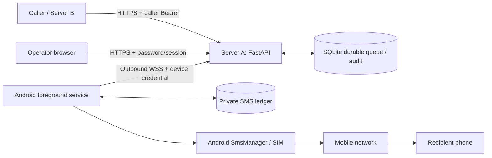

# Architecture and recovery

The phone initiates its connection; no inbound phone port, adb connection, or root is needed to send SMS. Server A owns acceptance, pacing, bulk template rendering, device eligibility, and recipient-hash routing. SQLite persists queued jobs and idempotency decisions before responding. One process owns active sockets; multiple workers/replicas sharing this queue are unsupported.

A healthy device has an authenticated connection, fresh heartbeat, selected ready SIM, permissions, and readiness. Offline work remains on the server. `auto` chooses an eligible authorized device with rendezvous hashing of the recipient and device ID. Undispatched jobs can be reassigned when a device becomes unavailable. A dispatched job stays pinned to its device to avoid duplicate cross-device submissions.

The phone durably acknowledges receipt before modem submission. It records multipart callbacks and reports outcomes through an acknowledged outbox. All parts must have successful sent callbacks for `sent`; carrier receipt parsing establishes `delivered`. A crash during a possible modem call produces an uncertain outcome; neither phone nor gateway blindly resends it. Late callbacks can resolve uncertainty. See [wire protocol](protocol.md).

Optional UI features run separately from SMS processing: landscape wall dashboard, one-hour bounded logs, adaptive window brightness, and seven-day battery history. Closing the Activity preserves the foreground relay. Root charging control applies only to supported Nokia hardware; its local guardian pauses at 80% and resumes at 60%. Signed admin-requested OTA waits for local work/status acknowledgements to drain before installation. No rooting/flashing is part of setup.
